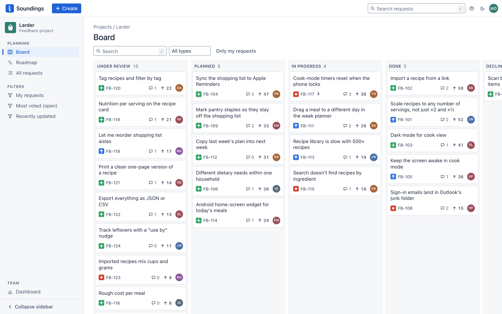
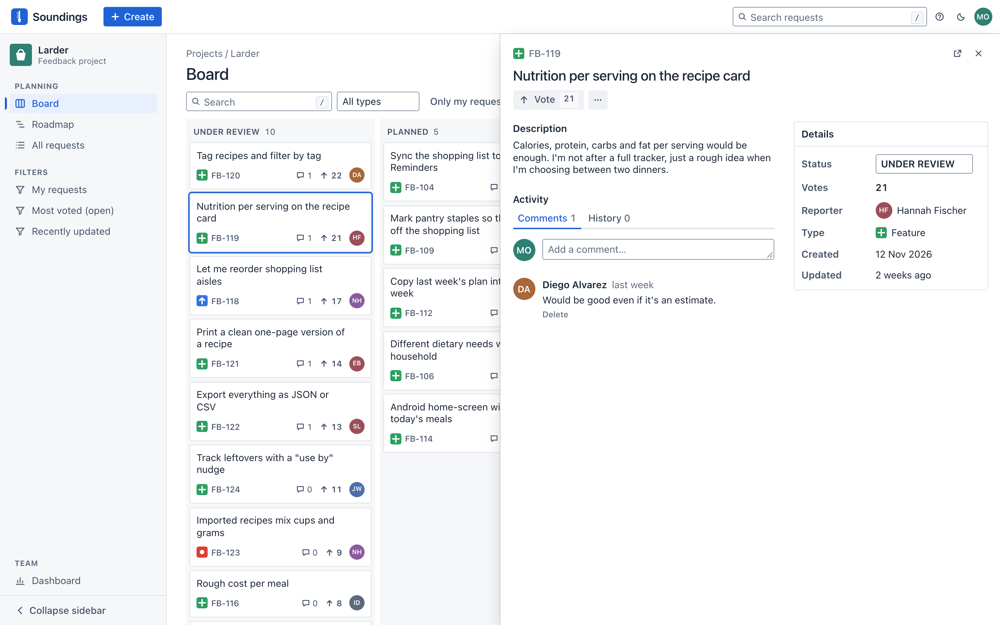
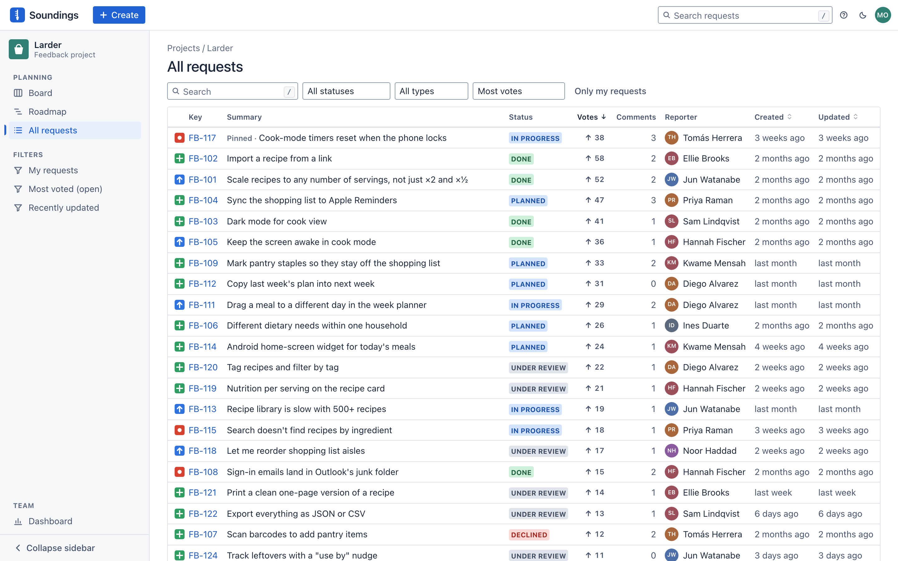
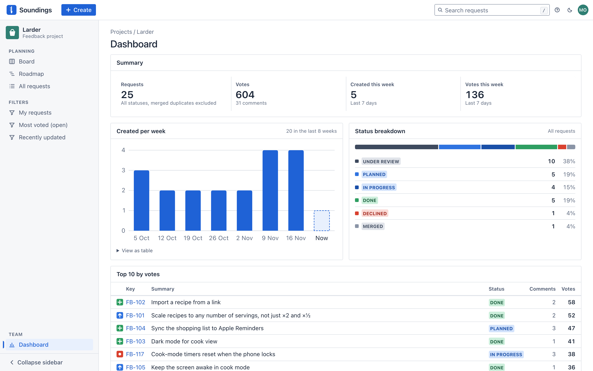
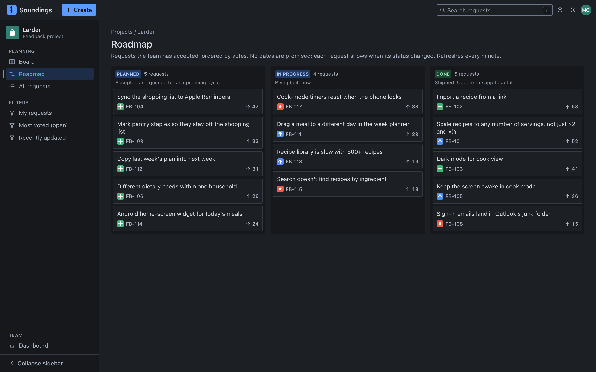

# Soundings

**A feedback board and public roadmap.** Members post feature requests and bug reports and vote on them, the team triages everything on a Kanban board, and anyone can follow the roadmap.

Built with a **Next.js** frontend and a **FastAPI** backend on **Supabase** (Postgres + Auth), deployed as two Vercel projects.

| | |
|---|---|
| **Live app** | https://soundings-m-ahnaff.vercel.app |
| **API** | https://soundings-api.vercel.app ([interactive docs](https://soundings-api.vercel.app/docs)) |



## Features

**For everyone**
- Browse requests on a **Kanban board** or in a dense, sortable **list**, and filter by status and type.
- **Search** titles and descriptions, or jump to a request by key (`FB-119` or `#119`).
- Sort by **Top**, **New**, **Trending** (votes in the last 7 days) or **Recently updated**.
- Follow a public **roadmap** with Planned / In progress / Done columns.

**For members** (email + password or magic-link sign-in)
- **Create requests** (feature, bug or improvement) in a "Create request" dialog that also suggests similar existing requests.
- **Vote** with one click; votes update instantly and are limited to one per person.
- **Comment**, and edit or delete your own requests while they're still under review.

**For admins**
- **Drag cards** between status columns, or use the keyboard-friendly Move menu.
- Change status, pin requests, and **merge duplicates**. Merging moves the votes over without double-counting and leaves a link on the duplicate.
- See a **dashboard** with totals, requests per week, status breakdown and the top 10 by votes.
- Every status change is recorded in the request's **History** tab.

**Polish**
- Requests open in a **side panel** with their own URL, and the browser's Back button closes the panel.
- **Keyboard shortcuts:** `c` create, `/` search, `j`/`k` move, `v` vote, `?` help.
- Light and dark themes, responsive down to phone width (the sidebar becomes a drawer), and AA contrast.

| Request details | All requests |
|---|---|
|  |  |
| **Dashboard** | **Roadmap (dark mode)** |
|  |  |

## Architecture

```
 Browser ── Next.js (Vercel) ──────────────► FastAPI (Vercel) ─────► Supabase PostgREST ─► Postgres
   │        server components + client UI    verifies the user's JWT   forwards the SAME JWT   RLS on every table
   └─────── Supabase Auth (sign-in, magic links, session refresh)
```

- **The backend holds no secrets.** FastAPI verifies each user's Supabase token against the project's public signing keys (JWKS, ES256), then forwards that **same token** to the database. Postgres **Row Level Security** therefore decides what every request may do. The API has no service-role key and no database password.
- **Rules live in the database.** Triggers protect columns (only admins change status), keep vote and comment counts accurate, log history, block votes on merged posts, and rate-limit writes.
- **The API is typed and versioned:** `/v1/...` routes, pydantic models, one consistent error shape and OpenAPI docs.
- **Demo mode:** with no Supabase configured, the API runs an in-memory store with realistic seed data, and the UI shows a "View as: Signed out / Member / Admin" switch. It can't be enabled in production.

More detail: [docs/ARCHITECTURE.md](docs/ARCHITECTURE.md) · [docs/API.md](docs/API.md) · [SECURITY.md](SECURITY.md)

## Tech stack

| Layer | Tech |
|---|---|
| Frontend | Next.js 16 (App Router), React, TypeScript (strict), Tailwind CSS v4, `@supabase/ssr` |
| Backend | FastAPI, Python 3.12, pydantic v2, httpx, PyJWT; managed with `uv` |
| Database and auth | Supabase: Postgres, Auth, Row Level Security, SQL triggers and RPCs |
| Quality | pytest (66 tests), ruff, ESLint, `tsc`, GitHub Actions CI |
| Hosting | Vercel (two projects: `web/` and `api/`) |

## Run it locally

You don't need a Supabase account for this. Demo mode uses seeded in-memory data.

```bash
# 1. API on :8800 (in-memory demo store)
cd api
uv sync
uv run uvicorn index:app --port 8800

# 2. Web on :3100 (in a second terminal)
cd web
npm install
npm run dev
```

Open http://localhost:3100 and use the **View as** switch in the top bar to act as a visitor, a member or an admin.

### Run the checks

```bash
cd api && uv run ruff check . && uv run ruff format --check . && uv run pytest -q
cd web && npm run lint && npm run typecheck && npm run build
```

## Deploy your own

1. Create a Supabase project and run [`supabase/schema.sql`](supabase/schema.sql) in its SQL Editor.
2. Deploy `api/` and `web/` as two Vercel projects with the environment variables below.
3. Point Supabase Auth's Site URL and Redirect URLs at your web URL.
4. Promote yourself to admin with the one-liner at the top of the schema file.

Step by step: [docs/DEPLOYMENT.md](docs/DEPLOYMENT.md).

| Project | Variable | Example |
|---|---|---|
| `api/` | `SUPABASE_URL` | `https://<ref>.supabase.co` |
| | `SUPABASE_PUBLISHABLE_KEY` | `sb_publishable_…` (public key; RLS protects the data) |
| | `CORS_ORIGINS` | `https://your-web.vercel.app` |
| `web/` | `NEXT_PUBLIC_SUPABASE_URL` | `https://<ref>.supabase.co` |
| | `NEXT_PUBLIC_SUPABASE_PUBLISHABLE_KEY` | `sb_publishable_…` |
| | `NEXT_PUBLIC_API_URL` | `https://your-api.vercel.app` |
| | `NEXT_PUBLIC_BOARD_NAME` | *(optional)* the product the board collects feedback for |

## Project structure

```
api/                 FastAPI service
  app/main.py          routes (/v1/...), error handling, CORS
  app/auth.py          JWT verification against Supabase JWKS
  app/repo/            data layer: postgrest.py (Supabase) and memory.py + seed.py (demo)
  tests/               pytest suite (auth, permissions, votes, merge, pagination, errors)
  index.py             Vercel entry point
web/                 Next.js app
  src/app/             routes: board (/), /requests, /roadmap, /admin, /p/[id], /login, /auth
  src/components/      app shell, board, list, issue panel, dialogs, charts
supabase/schema.sql  tables, RLS policies, triggers, RPCs (safe to re-run)
docs/                architecture, API reference, deployment guide, screenshots
```

## License

[MIT](LICENSE) © m-ahnaff
